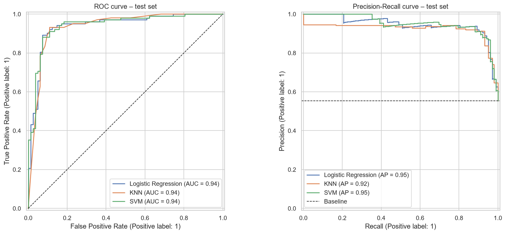
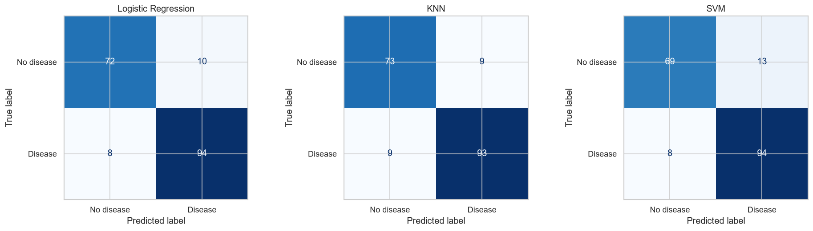

# Heart Disease Prediction

**Python · Pandas · Scikit-learn · Matplotlib · Seaborn**

Predicting the presence of heart disease from 11 clinical attributes (918 patients) with an end-to-end scikit-learn pipeline.

## Highlights

- **EDA:** distributions, correlations (Pearson, point-biserial, Cramér's V), outlier analysis (IQR) and key-feature ranking (mutual information).
- **Data preprocessing:** found that `Cholesterol = 0` (172 rows) and `RestingBP = 0` are hidden missing values; converted them to `NaN` and imputed inside the pipeline to avoid data leakage.
- **Feature engineering:** `Chol_missing` flag, `HR_reserve = MaxHR / (220 − Age)`, `Oldpeak_pos`.
- **End-to-end ML pipeline:** `FeatureEngineer → ColumnTransformer (impute + scale + one-hot) → SelectKBest → model`.
- **Hyperparameter tuning:** `GridSearchCV` with 5-fold stratified CV, tuning feature selection (`k`) and model parameters together.
- **Model comparison:** Logistic Regression, KNN and SVM evaluated with ROC-AUC and PR-AUC.

## Results (held-out test set, 20% stratified split)

| Model | CV ROC-AUC | Test ROC-AUC | Test PR-AUC | Accuracy | F1 |
|---|---|---|---|---|---|
| **SVM (RBF)** | 0.9340 | **0.9427** | **0.9511** | 0.8859 | 0.8995 |
| Logistic Regression | 0.9323 | 0.9393 | 0.9453 | 0.9022 | 0.9126 |
| KNN | 0.9312 | 0.9353 | 0.9234 | 0.9022 | 0.9118 |

Baseline Logistic Regression (no feature engineering or tuning): 0.9193 ROC-AUC.




## Key findings from EDA

- `ST_Slope` (Flat/Down), `ChestPainType = ASY`, `ExerciseAngina = Y`, higher `Oldpeak` and lower `MaxHR` are the strongest indicators of heart disease.
- Men have a much higher disease rate (63%) than women (26%).
- Patients with unrecorded cholesterol have an 88% disease rate, so the missing-value flag is a useful feature.

## Project structure

```
├── data/heart.csv                     # dataset
├── heart_disease_prediction.ipynb     # full analysis and modelling notebook
├── images/                            # figures used in this README
├── requirements.txt
└── README.md
```

## How to run

```bash
pip install -r requirements.txt
jupyter notebook heart_disease_prediction.ipynb
```

## Dataset

[Heart Failure Prediction Dataset](https://www.kaggle.com/datasets/fedesoriano/heart-failure-prediction) (918 observations, 11 features).
